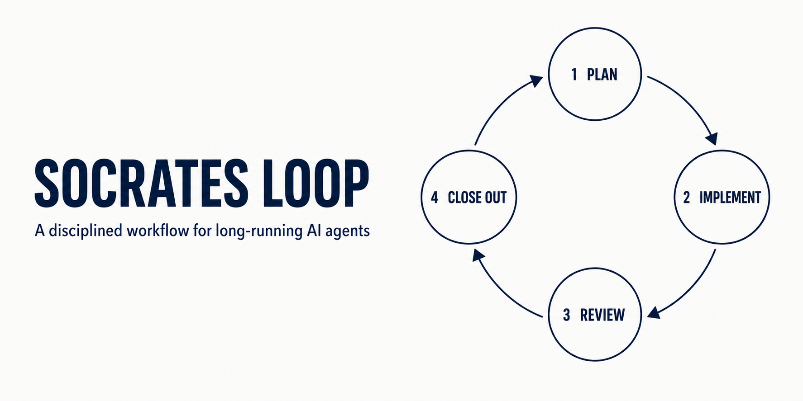

# Socrates Loop

Socrates Loop is a small set of Markdown templates for bootstrapping repository-specific instructions and a four-phase AI-assisted development workflow. It separates durable repository guidance from task plans, working memory, and diagnostic artifacts.

## How it works

Socrates Loop turns a long-running agent task into a sequence of inspectable, verifiable stages:

**Specification → Plan → Implement → Review → Learn → Next task**

1. **Plan:** The agent studies the repository, relevant maintained docs and any completed task closeouts without editing tracked files, then writes a task brief with constraints, milestones, success criteria, risks, and verification commands. Work pauses for approval.
2. **Implement:** The agent executes the approved plan in small change sets, verifies each set, and records investigation evidence outside the permanent repository guidance.
3. **Review and debug:** The user reviews the result. The agent handles failures with a reproduce, hypothesize, test, and surgical-fix loop.
4. **Close out:** The agent reconciles affected documentation, replacing superseded guidance and preserving unique historical evidence. It archives sanitized task records and a closeout that supports future Phase 1 planning, then marks the task complete.

## Why it works

- **Documentation has bounded owners.** Each topic has an owner; superseded guidance is replaced rather than accumulated.
- **Intent is inspectable before implementation.** Milestones, success criteria, invariants, and verification commands make drift visible while it is still inexpensive to correct.
- **Working evidence has a defined home.** Reproduction commands, hypotheses, failed experiments, and bug-impact records live in memory rather than being lost in chat history.
- **Human approval remains part of the loop.** The workflow creates explicit checkpoints before implementation and before closeout.
- **Useful history informs the next plan.** Relevant closeouts supply decisions, outcomes and follow-ups; deeper archives resolve questions left unanswered.

This is a human-guided engineering workflow, not an autonomous orchestration system. Its purpose is to help an agent work for longer without losing the goal, repeating mistakes, or silently changing important assumptions.

## Documentation roles

The ownership table in `AGENTS.md` maps roles to repository-specific files or sections. The maintenance rules live under its working agreement and apply throughout the task.

| Layer | Purpose |
|---|---|
| `AGENTS.md` | Working rules, essential constraints and documentation routing |
| Maintained documentation, including `README.md` | Current behavior, procedures, architecture and project state, as applicable |
| `.agent/TASK_BRIEF.md` and `.agent/MEMORY.md` | Active task scope/state and supporting investigation |
| Archived `CLOSEOUT.md` | Historical task context used primarily to construct a new task brief in Phase 1 |
| Deeper archived task records | Supporting detail when a closeout leaves a material question unanswered |

Small repositories can use README sections for several maintained roles. Separate project-state, architecture, operations, metrics or design documents are optional. Closeout reviews affected owners; it does not require every task to add permanent guidance.

## Repository contents

| File | Purpose |
| --- | --- |
| [`install.py`](install.py) | Installs the templates in a target project and displays the zero prompts. |
| [`AGENTS_TEMPLATE.md`](AGENTS_TEMPLATE.md) | Customizable repository guidance and the four-phase working agreement. |
| [`Agent-Zero-prompt.md`](Agent-Zero-prompt.md) | Bootstrap prompts for existing repositories and new repositories that begin with a design specification. |
| [`Update-prompt.md`](Update-prompt.md) | Instructions and acceptance checks for updating an installed integration as a normal task. |
| [`TASK_BRIEF_TEMPLATE.md`](TASK_BRIEF_TEMPLATE.md) | Task scope, status, milestones, success criteria, implementation plan, and decisions. |
| [`MEMORY_TEMPLATE.md`](MEMORY_TEMPLATE.md) | Compact investigation evidence, gotchas, bug-impact records, and verification results. |
| [`docs/assets/social-preview.png`](docs/assets/social-preview.png) | Source image for the repository’s GitHub social preview. |
| [`LICENSE`](LICENSE) | MIT license terms. |

## Setup

Requires Python 3 and an existing target repository:

```bash
git clone https://github.com/jlong29/socrates-loop.git
python3 socrates-loop/install.py /path/to/your/repo
```

Use an absolute path or one relative to your current directory; quote paths containing spaces. Add `--dry-run` to preview changes. On Windows, use `py` if that is your Python launcher.

The installer copies templates, creates `.agent/logs/`, updates `.gitignore`, and prints both zero prompts. Existing guidance and task records are preserved; conflicting templates stop installation.

---

## Getting Started

Open the target repository in your coding agent and paste the appropriate printed zero prompt: **Existing Repo** or **New Repo with design specification**. For the latter, replace `MY_DESIGN.md` with your design document's path. Both prompts are also in [`Agent-Zero-prompt.md`](Agent-Zero-prompt.md).

See the [Ask Socrates walkthrough](docs/example-walkthrough.md) for a complete task, including resuming work in a new session.

## Updating an installation

Updating Socrates Loop is a Socrates Loop task in the target repository. Its existing four-phase working agreement supplies planning, approval, implementation, review, and closeout. Start when no other task is active; the update itself has normal task records.

Refresh or select a local Socrates Loop checkout, then open your coding agent in the target repository. For example:

```bash
cd /path/to/socrates-loop
git pull --ff-only
cd /path/to/your/repo
```

Give the agent this request, replacing the source path:

> Update this repository's Socrates Loop integration using `/path/to/socrates-loop` as the source. Read that checkout's `Update-prompt.md` and follow this repository's existing four-phase working agreement. Begin with a Phase 1 task brief and stop for approval. Preserve repository-specific guidance and history; explicitly propose any structural changes or replacement of customized policy.

[The update prompt](Update-prompt.md) supplies update-specific scope and acceptance checks. The agent compares the installed policy and templates directly with the selected source, adapts repository-specific sections such as documentation ownership, and iterates on verification before presenting the result for review. The task brief and closeout record the source revision, changes, and evidence.

The installer remains the initial setup path. Updating needs no prior upstream checkout or installation-state database: the agent reviews differences between the current integration and the selected source. The plan identifies local customizations and seeks approval for their disposition.

An agent may also obtain the source from the public repository at one identified revision and follow the same prompt. A local checkout makes the exact reference available without network access during the task. Keep the source contents fixed until the update is complete.

## Development checks

Run the installer regression suite from this checkout:

```bash
python3 -B -m unittest discover -s tests -v
```

Tests use isolated temporary projects and do not update another repository. The Git ignore-behavior test requires Git and skips when it is unavailable.

Feedback and contributions are welcome. [Open an issue](https://github.com/jlong29/socrates-loop/issues/new) to report a problem or suggest an improvement, or [submit a pull request](https://github.com/jlong29/socrates-loop/pulls) with a proposed change.

---

## License

This project is available under the [MIT License](LICENSE).
