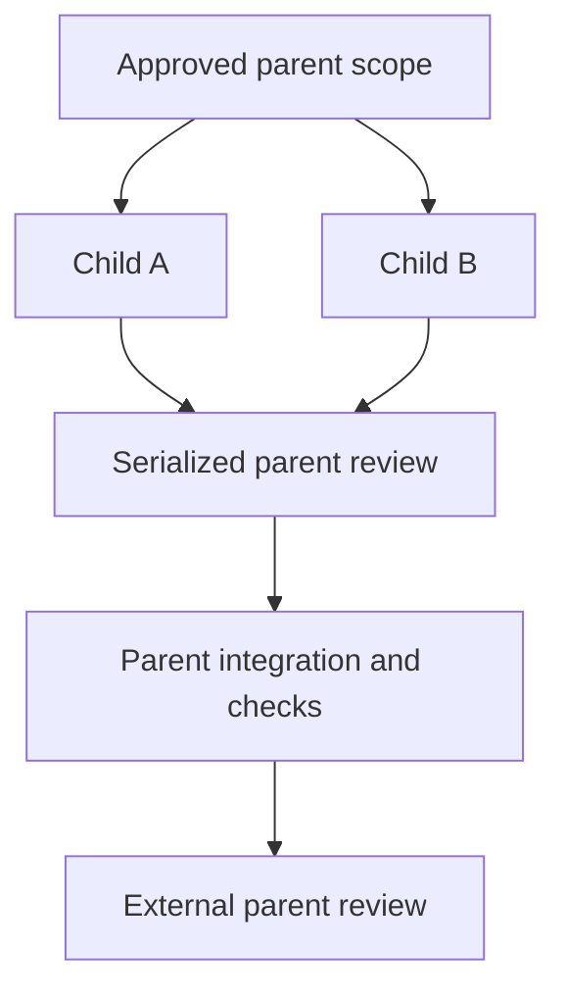

# Socrates Orchestrator: local execution and review protocol

This document owns the design and operating procedure for the optional `socrates_orchestrator` runtime. The Markdown workflow remains usable on its own. The runtime applies that workflow to one parent task and a bounded collection of child tasks on one Linux host.

The implementation is an initial version for review. Its automated checks use deterministic fake agent processes and real temporary Git repositories. They exercise orchestration mechanics; they do not establish the quality of live model judgments or long-project reliability. Read [implemented scope and limits](#12-implemented-scope-and-limits) before adapting it to a project.

## 1. What this adds

The runtime makes a Socrates handoff executable:

1. A child process prepares a plan and exits at its approval boundary.
2. A parent review turn evaluates that plan within the approved parent task.
3. The child implements the accepted plan and exits with a review request.
4. The supervisor captures a candidate, verifies its identity and runs the assigned checks.
5. A serialized parent review turn accepts that exact candidate, requests repairs or reports a blocker.
6. The child repairs in Phase 3 or proceeds to Phase 4.
7. The parent reviews the final closed candidate, including documentation and archive changes.
8. The supervisor integrates the accepted candidate into the parent branch and verifies the combined result. Once the parent handoff is ready, it removes eligible child worktrees when automatic cleanup is enabled.

The parent is a Socrates agent. A small deterministic supervisor runs the processes and enforces transitions. The supervisor does not decide whether an implementation satisfies a requirement; the agent reviewer makes that judgment from approved intent and evidence. Conversely, an agent's success message cannot change the ledger, approve its own work or merge an unaccepted version.

## 2. Preserve the parent task

Suppose a parent has milestones M1–M10 and criteria S1–S10. Two independent children can own M1–M5/S1–S5 and M6–M10/S6–S10. The parent retains its original outcomes and adds coordination work such as reviewing child plans, accepting candidates and checking integration.

Do not rewrite the parent task into “launch two agents and merge their results.” Finishing those actions does not demonstrate that S1–S10 hold. Criteria that involve composition, overall performance, shared behavior or a complete user journey remain assigned to the parent.

Before choosing delegation, assess:

- Whether the deliverables and criteria have clear owners.
- Whether interfaces are stable enough for separate implementations.
- Which files or documentation owners overlap.
- Whether expected time savings justify planning, review and integration work.
- Who owns assembling the result and resolving discrepancies.

Keep tightly coupled work in one task when those costs dominate. A task count or milestone number alone is not a partitioning rule.

## 3. One policy, different assignments

Every child and parent turn uses the same approved repository working agreement. The parent does not receive a separate, weaker policy. The manifest supplies task scope, reviewer assignments and explicit delegation authority. A turn's sandbox and allowed operations follow its role.

| Role | Responsibility | Boundary |
|---|---|---|
| Child author | Plan, implement, verify, repair and close out its assigned task | Cannot approve its own result or merge into the parent branch |
| Parent reviewer | Assess child scope and outcomes against both child and parent requirements | Reviews read-only; cannot silently relax criteria or replace the parent's active task records |
| Supervisor | Validate identities, maintain state, schedule turns, snapshot, integrate and clean up | Has only the local integration authority explicitly recorded at initialization |
| Final reviewer | Accept the assembled parent result | Remains external to the parent implementation/review loop |

The current canonical workflow already permits coherent, verified local commits in Phases 2–4. This runtime assigns their execution to the supervisor for every agent role: workers yield coherent changes, and the supervisor commits the handoff after checking its scope. Workers do not commit, stage integration, change branches or perform other Git lifecycle operations themselves. This common capability assignment is recorded in the pinned orchestration protocol; the parent receives no separate policy. Delegated review and named local integration authority remain explicit additions, not a blanket exception permitting all Git operations.

The supervisor pins repository policy files by digest. The default includes the root `AGENTS.md` and relevant tracked nested agent guidance and `.codex` configuration. The manifest can identify additional policy inputs. A policy change invalidates the run's assumptions instead of being propagated silently between workers. This identifies the repository policy; model behavior, system instructions and external client configuration still require a consistent operator environment.

### Phase identity is per task

The parent remains in **Phase 2** while it dispatches and reviews its children. A child can simultaneously be in Phase 1, Phase 3 or Phase 4. Reviewing a child does not advance the parent's own phase.

The parent reaches **Phase 3** only after its assembled result is ready for the final reviewer. It does not approve its own overall result merely because it approved every child. Phase 4 for the parent follows that final acceptance under the normal working agreement.

## 4. Documents, graph and ledger have different owners

| Artifact | Owns |
|---|---|
| Approved parent brief | Original goal, milestones, success criteria, constraints and authorized delegation |
| Frozen run manifest | Stable IDs, criterion assignments, dependency graph, reviewer relationships, limits and approved commands |
| Repository maintained documentation | Accepted current architecture, behavior and operating procedures |
| Child task brief and memory | Scoped plan, inherited obligations, decisions, evidence and next action |
| Candidate and review records | Exact subject version, verification evidence and reviewer decision |
| SQLite ledger | Observed invocation/task state, accepted transitions, integration state and event history |
| Git commits and archives | Durable code/documentation versions and task outcomes |

The approved brief remains the source of task intent. For an orchestrated run, the ledger owns execution state. This version freezes the entire parent brief, including the active source file, for the duration of the run. `STATUS.md` in the run directory supplies current progress; parent review turns must not edit the frozen brief to update status. Reconcile the parent task records when taking over the final handoff. Child records are updated at their own handoffs. Changing a checkbox cannot release a dependency. This is an explicit extension of the informal single-agent brief/state convention.

Each worktree has its own `.agent/TASK_BRIEF.md` and `.agent/MEMORY.md`. Parent review runs in the parent worktree and receives explicit child candidate paths. It must not treat the child's brief as a replacement for its own parent task.

### Three kinds of graph relationship

- **Containment:** the parent delegates part of its approved task to a child.
- **Prerequisite:** a child requires another child's accepted and integrated output.
- **Review assignment:** the parent reviews a child's plan or candidate.

Only prerequisite edges participate in the execution DAG. Treating the parent review relationship as an ordinary reverse dependency would create a false cycle: the child would wait for a parent that is waiting for the child.



This diagram shows control flow. The manifest separately records any A-to-B prerequisite. Independent children can implement in parallel; the parent review session is used by one turn at a time.

## 5. Manifest version 1

The manifest is operator-authored or operator-approved input. Its authorization fields record a real decision; writing `true` does not create user approval. Initialization requires a separate `--approve` acknowledgement of the supplied parent plan and delegated permissions.

The following example illustrates the structure. Replace its task descriptions, paths and checks with the actual project's approved work; the example modules are not included in Socrates Loop.

```json
{
  "schema_version": 1,
  "run_id": "feature-a",
  "goal": "Deliver the approved feature on feature/A",
  "parent_brief": ".agent/TASK_BRIEF.md",
  "milestones": ["M1", "M2", "M3"],
  "criteria": [
    {"id": "S1", "text": "The parser satisfies the approved input contract"},
    {"id": "S2", "text": "The formatter preserves the approved output contract"},
    {"id": "S3", "text": "The complete feature works with both changes"}
  ],
  "parent_criteria": ["S3"],
  "tasks": [
    {
      "id": "parser",
      "title": "Implement the parser",
      "instructions": "Implement M1 and satisfy S1 under the approved contract.",
      "milestones": ["M1"],
      "criteria": ["S1"],
      "depends_on": [],
      "reviewer": "parent",
      "allowed_paths": ["src/parser.py", "tests/test_parser.py"],
      "verify": [["python3", "-m", "unittest", "tests.test_parser"]]
    },
    {
      "id": "formatter",
      "title": "Implement the formatter",
      "instructions": "Implement M2 and satisfy S2 under the approved contract.",
      "milestones": ["M2"],
      "criteria": ["S2"],
      "depends_on": [],
      "reviewer": "parent",
      "allowed_paths": ["src/formatter.py", "tests/test_formatter.py"],
      "verify": [["python3", "-m", "unittest", "tests.test_formatter"]]
    }
  ],
  "integration_verify": [["python3", "-m", "unittest", "discover", "-s", "tests"]],
  "policy_files": ["AGENTS.md"],
  "max_workers": 2,
  "max_attempts": 3,
  "timeout_seconds": 1800,
  "repair_mode": "resume",
  "cleanup": true,
  "authorization": {
    "parent_plan_approved": true,
    "delegate_plan_review": true,
    "delegate_result_review": true,
    "local_merge": true,
    "final_reviewer": "human"
  }
}
```

Criterion IDs refer to the retained parent scope. `parent_criteria` identifies criteria the parent must verify after composition. Each child lists its inherited subset; every original criterion must have a child or parent owner. The runtime validates criterion references, coverage and graph structure. Milestones are descriptive strings: using stable labels such as M1 is recommended, but this version does not mechanically prove that child milestone descriptions cover the parent milestones. The reviewer checks that mapping and the semantic adequacy of the partition.

`allowed_paths` declares relative file paths or directory prefixes ending in `/`, not shell expressions. For example, `src/parser.py` permits that file, while `src/parser/` permits files under that directory. A child's assigned archive under `docs/agent/tasks/<run_id>/<task_id>/` is separately permitted during closeout. This does not grant general ownership of all documentation.

Verification commands are argument arrays. They execute without constructing a shell command string. Supply the interpreter or project environment explicitly when necessary. A command's exit code is recorded as execution evidence; its adequacy for the stated criterion still requires review.

Two further optional manifest fields control integration. `merge_verify` is a list of argument arrays to run on every tentative merge before it is committed; it defaults to an empty list. `integration_verify` runs on the complete assembled parent tree. `integration_paths` lists additional approved paths for parent integration repairs, beyond the union of child deliverable paths and their assigned archives; it defaults to an empty list. An empty verification list records an evidence gap rather than proving behavior.

## 6. Linux setup and commands

The runtime requires Python 3.11 or later, Git, a Linux host and a configured Codex CLI for live execution. It uses the Python standard library. Template installation remains a separate Python 3 operation and does not require launching Codex.

Use an existing dedicated project branch such as `feature/A`, with a clean committed baseline and committed repository policy. Initialization rejects `main` and `master`; choose an appropriate feature branch even when the project's default branch has another name. Keep the parent's current approved task records in its ignored `.agent/` directory. Choose a new run directory outside the repository and its worktrees, so candidate records, invocation logs and the database cannot accidentally enter a project commit.

From the Socrates Loop source checkout:

```bash
python3 -m socrates_orchestrator init \
  --repo /path/to/project \
  --manifest /path/to/approved-manifest.json \
  --run-dir /path/to/runs/feature-a \
  --approve

python3 -m socrates_orchestrator run --run-dir /path/to/runs/feature-a
python3 -m socrates_orchestrator status --run-dir /path/to/runs/feature-a
python3 -m socrates_orchestrator status --run-dir /path/to/runs/feature-a --json
```

Initialization is the local run boundary. It fixes the parent brief, manifest, baseline and policy identities. It does not change the user's project requirements, push a branch, create a pull request or authorize a merge into `main`.

`run` uses `codex` by default. `--codex /path/to/executable` selects a compatible executable for a controlled environment or test fixture. The executable receives arguments directly; it is not a shell snippet.

Inspect the module's `--help` output for exact options. The [package](../socrates_orchestrator/) owns command behavior; this document explains its workflow and limits.

## 7. Child lifecycle and review candidates

| Child stage | Trigger | Required result |
|---|---|---|
| Phase 1 planning | Approved parent delegation and accepted prerequisites | Scoped brief, evidence needed for planning, no implementation edits |
| Plan review | Child yields a plan | Parent accepts or returns concrete findings within the frozen parent scope |
| Phase 2 implementation | Accepted plan | Coherent verified changes and an explicit review request; the controller creates the candidate commit |
| Phase 3 review | Supervisor captures candidate | Parent checks exact version against child criteria and parent constraints |
| Phase 3 repair | Changes requested | Revised evidence and a new candidate; never automatic carryover of approval |
| Phase 4 closeout | Accepted implementation | Documentation reconciliation and all required archives |
| Final child review | Closed candidate captured | Acceptance of the actual tree and records that will be integrated |
| Integration | Final child acceptance | Recorded merge into parent branch, parent merge review and successful configured per-merge checks |

### Candidate identity

A candidate records the task, attempt, approved scope, input baseline, pinned policy, exact Git commit/tree, verification evidence and copied task records needed to understand it. Ignored `.agent/` records do not become shared merely because a Git branch exists; the controller preserves the required records explicitly.

The [optional review-candidate template](../templates/REVIEW_CANDIDATE_TEMPLATE.md) explains the human-readable evidence. It supplements machine records; it is not a second scheduling or approval database.

Before and after a review, the controller checks that the subject still matches the captured candidate. A review response must match the active task, attempt and candidate. Stale responses are evidence about their old subject, not permission to proceed on a new one.

### What the reviewer receives

The review prompt identifies its role and provides the common policy, immutable parent brief, child scope, criterion mapping, candidate version, verification results, relevant prior review findings and applicable downstream requirements. Parent-wide context is selected by relevance rather than loading every historical task.

The reviewer must distinguish:

- Expected behavior derived from approved requirements.
- What a check actually executed and observed.
- What source inspection suggests.
- Remaining assumptions or behavior that has not been tested.

The structured response expresses acceptance, actionable repairs or a blocker. It does not rewrite the manifest. A material change to parent intent, contracts or task allocation requires a separately authorized planning decision.

The current response object has exactly these fields:

```json
{
  "kind": "approved",
  "task_id": "parser",
  "operation": "review_result",
  "invocation_id": "the-supplied-invocation-id",
  "candidate_id": "the-supplied-candidate-id",
  "policy_hash": "the-supplied-policy-hash",
  "notes": "The recorded checks establish the delegated behavior.",
  "criteria": [
    {"id": "S1", "status": "passed", "evidence": "Exact check and result reference"}
  ]
}
```

The controller supplies identity values; agents echo them, rather than inventing replacements. Each assigned criterion appears exactly once with `passed`, `failed` or `not_checked` and a nonempty explanation. An `approved` response requires all assigned criteria to pass the applicable review. During **plan review**, this means the plan adequately addresses a criterion and its verification; it must not be presented as evidence that the unimplemented behavior already works. Implementation and closeout reviews assess the delivered result.

### Closeout is part of the accepted result

Phase 4 can change maintained documentation and produce tracked archives. Its final tree is therefore reviewed before integration; approval of the Phase 2 tree is insufficient.

Archives use `docs/agent/tasks/<run_id>/<task_id>/` and contain `TASK_BRIEF.md`, `MEMORY.md` and `CLOSEOUT.md`. If final review finds a substantive problem, the active task records are restored from the archive, prior candidate evidence is retained, and the child returns to Phase 3. After repair acceptance it closes out again. The supervisor does not discard earlier review history to make the latest state appear successful.

## 8. Finite processes, persistent task identity

The process adapter runs one bounded `codex exec` invocation per turn. It sends the prompt on standard input, captures JSONL lifecycle events and stderr, requests a structured final result, and saves the exact invocation inputs. It uses direct subprocess argument arrays with an explicit working directory; it does not interpolate prompts into shell commands.

An implementation process ends at a gate. The supervisor then launches a parent review turn. If repairs are needed, it launches the child again using either the recorded thread ID or a fresh conversation, according to `repair_mode` and recovery choices. Resuming a thread restores conversational context; it does not revive a suspended Unix process.

Do not use `--last` to identify a session in parallel orchestration. The ledger retains the exact parent and child thread IDs. The parent review session has a serialized queue, while independent child turns can run concurrently up to `max_workers`. Integration repair uses a separate recorded `repair_session_id` with write access; it does not turn the read-only reviewer conversation into the author of the changes it will assess. Both sessions work within the same parent's Phase 2, approved scope and shared policy. A process invocation is not a new task that restarts the four phases.

The adapter requires both successful process completion and a valid expected result. A missing completion event, nonzero exit, malformed JSON, identity mismatch or missing final result is a failure, even if another log line says “done.” The controller additionally validates the domain transition and candidate; JSON schema compliance alone cannot approve work.

Timeout and cancellation cleanup terminate the invocation's process group and drain outputs. Remaining same-group background processes are also stopped after a successful finite turn. Processes that deliberately create a separate session escape ordinary process-group containment; stronger host isolation is outside this version.

### Implementation boundaries

| Module | Owns |
|---|---|
| `manifest.py` | Strict manifest parsing, authorization fields, criterion coverage and DAG validation |
| `policy.py` | The common orchestration capability assignment and handoff rules supplied to every turn |
| `protocol.py` | Structured result shape, identity matching and criterion evidence validation |
| `process.py` | One finite agent subprocess, streams, session identity, timeout and cancellation cleanup |
| `verification.py` | Approved command execution and retained results |
| `ledger.py` | Local writer lock, transactional records/events and revision comparisons |
| `git.py` | Guarded snapshots, worktrees, exact merges, archive refs and conservative removal |
| `controller.py` | State-machine decisions, scheduling, review dispatch, integration and reconciliation |
| `__main__.py` | Operator-facing commands |

The controller is responsible for cross-module invariants. For example, a Git helper can establish that a commit is exactly the requested commit, but only the controller can establish that the applicable reviewer accepted it under the current manifest.

## 9. Git integration on one parent branch

`feature/A` is the parent integration branch. Child branches are temporary implementation workspaces, not separate deliverables requiring separate PRs.

1. Initialization pins the parent baseline `H0`.
2. Independent root children start from `H0`, even when one is dispatched later because of the worker limit.
3. A child with prerequisites starts only after all prerequisites are accepted and integrated. Its actual baseline is the then-current parent head, recorded explicitly. That baseline may also contain unrelated accepted children.
4. Accepted, closed child commits are merged sequentially into A with ordinary merges that preserve ancestry.
5. Configured `merge_verify` checks and parent integration review run on the tentative parent tree before the merge is committed and dependent work is released. The complete `integration_verify` suite runs after all children are integrated.
6. The completed parent branch supports one final review and one PR to the intended target.

The controller must not rebase a candidate silently after review. A different base, conflict resolution or integration repair creates a different result whose verification and acceptance must be recorded.

Ordinary merge ancestry keeps accepted candidate commits reachable from the parent branch. A future squash policy would need an explicit retention and provenance scheme rather than assuming candidate SHA references will remain durable after child branch deletion.

### Merge conflicts

A merge conflict pauses integration and preserves the worktree and conflict evidence. It does not authorize the controller to choose arbitrary resolutions or discard either branch.

For an approved attempt to resolve the recorded conflict:

```bash
python3 -m socrates_orchestrator run \
  --run-dir /path/to/runs/feature-a \
  --repair-conflicts
```

The repair turn uses the same policy and the original parent criteria, in a dedicated author session separate from the parent reviewer. Its authority is limited to the recorded integration conflict and approved paths. The resolved result must pass verification and read-only parent review; the merge retains both parents so the repair remains attributable. A result that needs a scope or contract change becomes a blocker for a new planning decision.

### Combined verification failures

Successful individual merges can still produce a failing combined result. `integration_verify` checks the complete graph's assembled tree. By default a failure leaves the run blocked with a review packet and all evidence retained.

To request bounded parent Phase 2 repair within the already approved integration paths:

```bash
python3 -m socrates_orchestrator run \
  --run-dir /path/to/runs/feature-a \
  --repair-integration
```

The dedicated repair session receives the failed checks and accepted child history. The controller verifies scope, commits the repair without rewriting child ancestry, and reruns the complete verification. Attempts remain bounded. This is still parent implementation; its final commit awaits the external parent reviewer. A passing combined check and a prepared handoff are not automatic root approval.

### Worktree cleanup

With `cleanup: true`, automatic cleanup runs when the parent is ready for its external review. The controller may remove a child worktree only after final child acceptance, successful integration, archive verification and a cleanliness check. It retains local agent evidence in the run directory before removing the worktree. It does not force-delete dirty worktrees or remove the parent integration worktree. Failed or conflicted work remains available for diagnosis.

Ignored data outside `.agent/`, including a virtual environment or generated build/cache files, also prevents automatic removal. Git's ordinary “clean” status alone is insufficient to discard those files. The status report explains retained worktrees so an operator can preserve or deliberately remove that data. Child branches and immutable archive refs are retained by the initial controller; removing an eligible worktree does not delete its accepted history.

Cleanup can be requested again after reviewing retained work:

```bash
python3 -m socrates_orchestrator cleanup --run-dir /path/to/runs/feature-a
```

Persistent run records and accepted Git ancestry survive worktree removal. This is cleanup of a completed workspace, not erasure of the task's evidence.

## 10. State, failure and recovery

The SQLite ledger uses one local writer lock, revision comparisons and transactional state/event updates. A second advisory lock in the common Git directory prevents supervisors with different run directories from concurrently writing the same repository. These locks coordinate this runtime; they do not stop an unrelated user or tool from editing Git directly. The controller also checks branch and commit identities before mutations. A status reader can inspect durable state while the writer is active.

SQLite transactions do not make an external model invocation or Git command part of the same atomic transaction. The controller records action identity and reconciles the filesystem, processes and Git state after interruption; it must not assume that an action failed merely because its completion was not recorded.

Use `status` and the preserved invocation records to establish what happened. Before retrying an interrupted task, confirm that its old processes have stopped and that no other controller owns its workspace:

```bash
python3 -m socrates_orchestrator recover \
  --run-dir /path/to/runs/feature-a \
  --task parser \
  --acknowledge-stopped

python3 -m socrates_orchestrator run --run-dir /path/to/runs/feature-a
```

Add `--fresh-session` to recovery when the old conversation should not be reused. That changes the conversation, not the task identity, approved scope or requirements.

Recovery is explicit reconciliation. The acknowledgement is an operator assertion, not a process detector. A released database lock does not prove that every child has stopped. Ambiguous merge state, changed policy, changed parent history, unrecorded edits or insufficient approval evidence must remain blocked until resolved.

Creation and removal have separate intent records in the common Git directory. A creation interrupted before `git worktree add` can retry only when the exact recorded path, branch and Git registration are absent. If Git added the worktree but the active marker was not saved, explicit recovery accepts only the expected clean worktree at its original baseline. Removal records the exact tip and retained archive references before deleting the directory. A retry checks the path, registration, branch and retained history before completing an interrupted removal. It never uses force to resolve ambiguity.

Parent integration repairs also record intent before the author turn and the proposed tree before committing. If interrupted, `recover --task parent --acknowledge-stopped` preserves the work for another explicitly enabled repair turn. A commit made before the ledger update is adopted only when its exact tree and parent match the recorded intent; this records unreviewed parent implementation, not final acceptance. Pending child merges likewise require their recorded parents, exact tree and integration approval before a completed commit can be reconciled. Subsequent execution verifies the assembled result and still requires external review.

Worker operations and integration repairs have `max_attempts` limits; invocations are bounded by `timeout_seconds`. The attempt limit is per operation, not a total token or process budget for the entire project. Exhausting a budget produces a visible blocked state instead of an unbounded loop. The status report identifies retained work and the next decision. A failed check is not converted into acceptance by changing the expected result.

The run directory retains `manifest.json`, `policy.json`, the approved `parent-brief.md`, `ledger.sqlite3`, `STATUS.md`, invocation inputs/outputs, candidate records and verification logs. When the assembled result is ready or its combined verification fails, `REVIEW.md` and `review-packet.json` identify original criterion coverage, accepted child versions, merge commits, evidence and outstanding review. These are local run artifacts; select and sanitize the appropriate evidence when preparing a public PR.

## 11. Installed guidance and source updates are separate

This change adds source templates and an optional runtime. It does not update the repository's installed root `AGENTS.md` or installed templates under `docs/agent/`, and it does not change the installer's existing file mapping.

The installer still stages the canonical guidance template and installs the task brief and memory templates. `REVIEW_CANDIDATE_TEMPLATE.md` is an optional source reference used by the orchestration design; it is not silently copied into existing projects.

Before running orchestration in a target project, perform a normal integration-update task using [Update-prompt.md](../Update-prompt.md). Review the delegated-review policy, manifest ownership, workflow commands and documentation routing explicitly. Preserve existing local customizations. Complete and close out source-template development before a separate self-update of this repository's installed integration.

The runtime does not rewrite an old `AGENTS.md` to obtain the authority it needs. Initialization and an approved manifest are part of operating the installed policy, not a substitute for reviewing conflicting local guidance.

## 12. Implemented scope and limits

The initial implementation targets one parent branch, one local supervisor and a static task DAG. It supplies finite subprocess execution, task-specific worktrees, serialized parent review, durable records, exact candidate checking, bounded repairs, local integration and conservative recovery/cleanup. The scheduler reacts when a child lifecycle finishes, integrates eligible work and releases its dependents without waiting for unrelated workers to finish. Parent review and integration remain serialized; worker limits and those shared gates bound useful parallelism.

The following remain separate work:

- Live-agent evaluation across realistic projects and adversarial or ambiguous requirements.
- Dynamic graph revisions and versioned propagation of changed contracts during a run.
- Multiple levels of autonomous delegation or distributed scheduling across hosts.
- A transactional external queue or an exactly-once guarantee for arbitrary agent side effects.
- Automatic acceptance of the parent result, pushing branches, opening PRs or merging into the default branch.
- Strong process containment beyond the configured Codex sandbox and local process groups.
- A generic proof that individually accepted children preserve global correctness.

All policy, state and Git mechanisms support inspectability and narrower failure propagation. They do not remove the possibility that a plan, test or reviewer has misunderstood the requirement. The final parent review checks the original outcomes on the integrated tree and remains a distinct gate.

## 13. Validation and follow-on development

Run the repository tests from the checkout root:

```bash
python3 -B -m unittest discover -s tests -v
```

The orchestrator tests exercise the transport protocol with a fake agent executable and use temporary Git repositories for controller behavior. Coverage includes rejected stale candidates, phase-preserving repair, shared policy checks, serialized review, independent child progress, final closeout review, integration failures, cleanup preservation and explicit recovery. Installer and bootstrap regression checks remain part of the same suite.

A live CLI smoke attempt with `codex-cli 0.172.0-alpha.2` used a read-only, no-tool JSON request in a disposable repository. It failed before any model turn with `failed to initialize in-process app-server client: Read-only file system (os error 30)`. Live initialization, session resume and model reviews therefore remain unverified in this workspace. Repeat those checks in a writable Linux Codex environment and retain the exact CLI/configuration and results before claiming live execution support. The passing fake-process tests do not resolve this environment-specific initialization failure.

For live evaluation, begin with a small approved feature containing two separable children and one integration criterion. Record the model/CLI configuration, policy and manifest versions, review findings, repeated investigations, repair cost, integration defects and human interventions. Compare the final behavior with the original requirements; task throughput alone is not a drift measure.

When extending this version, preserve the following invariants in code and tests:

1. Intent and criteria are stable unless an authorized revision is recorded.
2. Review decisions bind exact subjects and cannot be reused after changes.
3. Task phase, runtime state and session identity are distinct.
4. Dependencies become ready through accepted integration, not worker claims.
5. Code, policy, documentation and archive changes are visible at the final gate.
6. Recovery preserves uncertainty and evidence rather than inventing completion.
7. Parent acceptance remains about the original project result.
